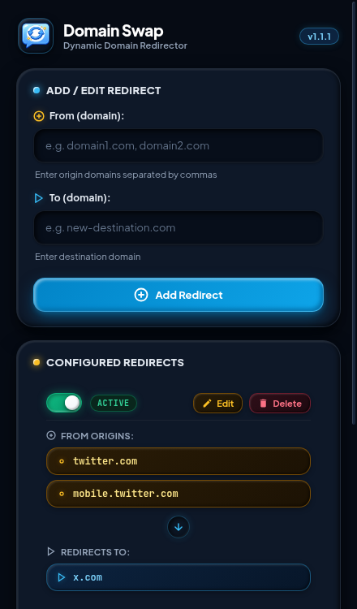
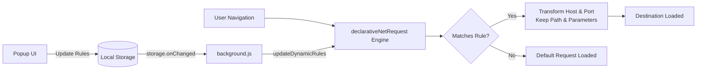

<div align="center">

  

  # Domain Swap
  
  **Lightweight, lightning-fast browser extension to dynamically redirect web domains with full path and query preservation.**

  [](manifest.json)
  [](manifest.json)
  [-brightgreen.svg?style=for-the-badge&logo=firefoxbrowser&logoColor=white)](https://addons.mozilla.org)
  [](#-privacy--security)
  [](LICENSE)

  <br />

  <p align="center">
    <a href="#-key-features">Key Features</a> •
    <a href="#-visual-preview">Preview</a> •
    <a href="#-installation">Installation</a> •
    <a href="#-how-it-works">How It Works</a> •
    <a href="#-json-import--export">Import & Export</a> •
    <a href="#-troubleshooting">Troubleshooting</a>
  </p>

  <br />

  

  <br />
</div>

---

## ⚡ Overview

**Domain Swap** empowers developers, QA testers, and privacy-conscious users to automatically reroute network requests from one domain to another on the fly. Whether migrating legacy staging environments to modern local containers (`localhost:3000`), routing third-party services to alternative frontends (e.g., `twitter.com` → `x.com`), or bypassing broken endpoints, Domain Swap performs redirections natively at the engine level without tracking, lag, or data leakage.

---

## ✨ Key Features

- **🚀 Native `declarativeNetRequest` Engine**: Bypasses heavy JavaScript event loops. Redirects happen instantly at the browser's network layer.
- **🛣️ Full Path & Query Preservation**: Seamlessly retains deep routes, URLs, hashes, and query parameters (e.g., `old-site.com/profile?id=42` → `new-site.com/profile?id=42`).
- **🌐 Multi-Origin Grouping**: Map multiple source domains into a single rule by separating them with commas (e.g. `domain.com, sub.domain.com` → `destination.com`).
- **🔌 Port-Aware Transformation**: Handles custom development ports effortlessly (e.g., redirecting to `localhost:8080` correctly clears old ports and applies the target).
- **🎨 Tactile Claymorphic UI**: High-contrast, tactile 3D interface designed for clarity, with animated status pills, origin chips, and clean transitions.
- **📋 In-Popup JSON Editor**: Inspect, edit, merge, or overwrite your rules directly through an integrated JSON drawer or by uploading `.json` files.
- **🔒 Zero Telemetry & Privacy Certified**: Operates 100% offline. Complies with Mozilla's strict built-in data collection consent requirements (`"data_collection_permissions": { "required": ["none"] }`).

---

## 📸 Visual Preview

| Feature | Description |
| :--- | :--- |
| **Tactile Rule Cards** | High-contrast chips distinguishing origin sources from target destinations with instant status toggle switches. |
| **Instant Quick Add** | Add or edit rules with automatic URL cleaning (stripping `https://`, trailing slashes, and paths). |
| **Raw JSON Drawer** | Paste rule configurations, upload backup files, and choose between non-destructive **Merge** or fresh **Overwrite**. |
| **1-Click Export** | Exports a downloadable `.json` file while automatically copying the raw configuration to your clipboard. |

---

## 🛠️ Architecture & Workflow

The extension combines standard WebExtension APIs with Chromium and Gecko cross-compatibility:



---

## 🚀 Installation

### Chromium Browsers (Chrome, Brave, Edge, Opera, Arc)

1. Clone or download this repository:
   ```bash
   git clone https://github.com/piposanchezman/domain-swap.git
   ```
2. Navigate to your browser's extension manager:
   - **Chrome / Brave**: `chrome://extensions/`
   - **Edge**: `edge://extensions/`
   - **Arc**: `arc://extensions/`
3. Toggle on **Developer mode** in the upper-right corner.
4. Click **Load unpacked** and select the root `domain-swap/` folder.

---

### Firefox & Firefox-based Browsers (LibreWolf, Waterfox, Floorp)

#### Option 1: Temporary Installation (Development)
1. Open Firefox and visit: `about:debugging#/runtime/this-firefox`
2. Click **Load Temporary Add-on...**
3. Select the `manifest.json` file inside the repository.

#### Option 2: Pre-packaged XPI
1. You can install the built `domain-swap.xpi` directly in developer/nightly editions or submit it for signing through [addons.mozilla.org (AMO)](https://addons.mozilla.org).
2. The package is pre-validated with `addons-linter` (0 errors, 0 warnings).

---

## 📖 Usage Guide

### 1. Adding a Redirect
1. Open the **Domain Swap** popup from your extensions toolbar.
2. In **From (domain)**: enter the source domain(s). You can enter multiple origins separated by commas:
   ```text
   twitter.com, mobile.twitter.com
   ```
3. In **To (domain)**: enter the target host (with optional port):
   ```text
   x.com
   ```
4. Click **Add Redirect**.

> [!TIP]
> Protocols (e.g. `https://`) and trailing slashes are cleaned automatically.

### 2. Managing Rules
- **Toggle On/Off**: Use the toggle switch to temporarily enable or disable any rule without deleting it.
- **Edit**: Click the **Edit** button to load the rule back into the form fields.
- **Delete**: Click **Delete** to immediately remove the rule and clean dynamic network conditions.

---

## 💾 JSON Import & Export

Domain Swap uses a clean, human-readable JSON schema for seamless backups and team sharing.

### Example Configuration:
```json
[
  {
    "id": 1,
    "from": [
      "twitter.com",
      "mobile.twitter.com"
    ],
    "to": "x.com",
    "enabled": true
  },
  {
    "id": 2,
    "from": "api.legacy.local",
    "to": "localhost:3000",
    "enabled": true
  }
]
```

### Import Modes:
- **Merge**: Appends new rules while preserving existing ones (matching targets will prevent duplicate rules).
- **Overwrite**: Replaces your current configuration entirely with the imported dataset.

---

## 📂 Project Structure

```text
domain-swap/
├── 📄 manifest.json        # Manifest V3 extension configuration (Chromium & Firefox)
├── ⚙️ background.js        # Background worker managing dynamic declarativeNetRequest rules
├── 🖼️ popup.html           # Popup UI structure with accessible DOM templates
├── 🎨 styles.css           # High-contrast tactile claymorphism styling tokens
├── 🧠 popup.js             # UI controllers, storage synchronization, and import/export logic
├── 📦 domain-swap.xpi      # Pre-built Firefox Add-on distribution archive
├── 🖼️ icon16.png / .webp   # App iconography (16x16)
├── 🖼️ icon48.png / .webp   # App iconography (48x48)
├── 🖼️ icon128.png / .webp  # App iconography (128x128)
└── 📄 README.md            # Project documentation and specifications
```

---

## 🔒 Privacy & Security

- **Zero Telemetry**: Domain Swap does not collect, log, transmit, or analyze any user browsing activity.
- **Local Storage Only**: All rules are persisted exclusively inside your browser's private local extension storage (`chrome.storage.local`).
- **Strict Content Security**: Free of dynamic `eval` or unsanitized DOM assignments (`innerHTML`). Built entirely using standard, secured DOM manipulation.

---

## 🛠️ Development & Packaging

To validate and package the extension for release:

```bash
# Lint extension against Mozilla Add-ons criteria
npx addons-linter domain-swap.xpi

# Package clean .xpi archive using Python
python3 -c "
import zipfile
files = ['manifest.json', 'background.js', 'popup.html', 'popup.js', 'styles.css', 'icon16.png', 'icon48.png', 'icon128.png', 'icon16.webp', 'icon48.webp', 'icon128.webp']
with zipfile.ZipFile('domain-swap.xpi', 'w', zipfile.ZIP_DEFLATED) as z:
    for f in files:
        z.write(f)
print('Package built successfully')
"
```

---

## 📄 License

This project is licensed under the **MIT License** — feel free to modify, distribute, and integrate it into your workflows.

---

<div align="center">
  <sub>Built with modern Web Standards • Maintained with ❤️</sub>
</div>
